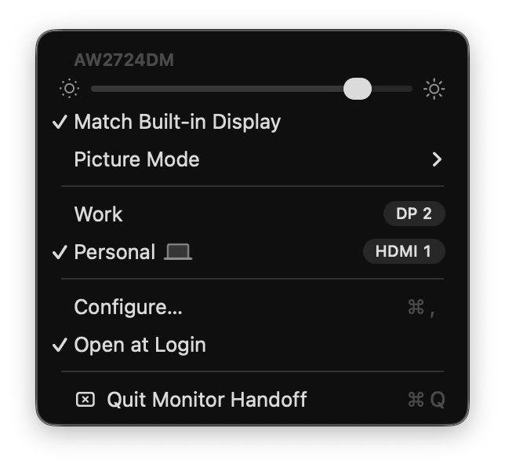

# Monitor Handoff

A macOS menu bar app for an external monitor shared by two computers. The monitor keeps all its
inputs alive, so when it switches to the other computer, macOS never notices and keeps drawing
on a screen nobody sees. Monitor Handoff reads the monitor's current input over DDC every two
seconds: when it is not this Mac's input, the display leaves macOS as if its cable were pulled;
when the monitor comes back, so does the display. Switch with the monitor's own buttons or from
the menu.



- The menu lists the monitor's inputs, as the monitor itself reports them, checks the current one
  and switches on a click. This Mac's input carries a laptop icon.
- A brightness slider sets the monitor's own backlight and opens at its current value. With Match
  Built-in Display on, the monitor takes the built-in screen's brightness, which macOS sets by its
  light sensor, and the slider only shows it. It copies only while this Mac is in use: an idle
  Mac dims its screen before sleep, and its sensor is silent while the screen sleeps, so
  meanwhile the monitor keeps its last brightness.
- Picture Mode lists the color presets and display modes the monitor declares, under their MCCS
  standard names, with the current ones checked. A monitor with a profile gets the modes its own
  menu shows instead; so far that is the AW2724DM with its 13 presets.
- Configure… gives the inputs names ("Personal", "Work"), hides unused ones and picks this Mac's
  input when the link type does not tell it.
- When this Mac locks or sleeps while the monitor shows it, the monitor can switch to another
  input, picked in Configure….
- The menu bar icon is struck through while the monitor is handed over and shows a warning when
  a monitor showing this Mac stops answering.
- Never removes the last screen: with the lid closed, the monitor stays.

## Requirements

- An Apple Silicon Mac, macOS 14 or later, the Command Line Tools (no Xcode).
- A monitor with DDC/CI on (usually a setting in its menu).
- One external monitor. Several have not been tested: when a second one is connected, the app
  puts back a display it removed, stops following and says so in the menu.
- Private APIs: IOAVService for DDC, CGSConfigureDisplayEnabled to remove the display. A macOS
  update may break either.

## Install

```bash
curl -fsSL https://raw.githubusercontent.com/Applemoon/monitor-handoff/main/install.sh | bash
```

Downloads the source, builds it, installs it into ~/Applications and starts it; run it again to
update. In a clone, `./install.sh` does the same with the code next to it. Open at Login is on
from the first launch and off from the menu.

## Notes from the monitor it was built on (Alienware AW2724DM)

- The second DisplayPort input is 0x13, not the standard 0x10, which only makes it blink.
- The current input is the low byte of VCP 0x60; the high byte carries something else.
- `m1ddc get` returns garbage over its HDMI link, while plain reads with the checksum checked
  work.
- DDC reaches the monitor while it shows another input and while its display is removed from
  macOS, which is what lets the app follow it.
- The preset is reported in Dell's VCP E2, which ignores writes. Standard and Game 1 are chosen
  through the display mode (DC), sRGB, Warm, Cool and Custom Color through the color preset (14),
  the rest through Dell's F0.

## Adding a monitor's picture modes

A profile in `Sources/PictureModes.swift` maps each mode to the VCP write that turns it on and the
VCP value that says it is on. To map a monitor: write each value it declares for its mode-like
features (in its capabilities string), read back what changed, and name each result after the
monitor's own menu.
